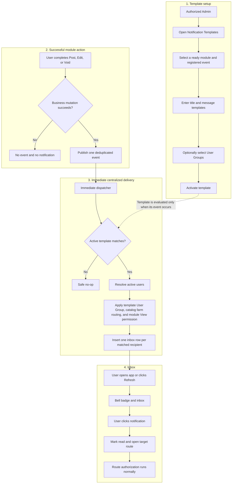

# Notification System Flow

The notification center is a compact, in-app template system. It has no browser polling, Realtime subscription, notification email queue, or scheduled notification worker.

Detailed design and deployment boundary: [Notification System Design](./notification-system-design.md)

## Recipient matching

- The module owns only the business event facts; it does not choose recipients.
- The event catalog owns module permission and farm-routing requirements.
- An empty User Group selection means every active user who passes farm and View-permission checks.
- Selected User Groups narrow that permitted audience.
- Super Admin retains the established farm-assignment bypass.
- A notification informs a user; it never grants module or document access.

## Reliability rules

- Failed or rolled-back business actions create no notification.
- An inactive or unmatched template is a safe no-op.
- Deterministic event and recipient identities prevent duplicate inbox rows.
- Unexpected notification dispatch errors must not turn a successful business action into a failed one.
- Notification rows are created only when a real event is emitted; empty queues are never polled.
